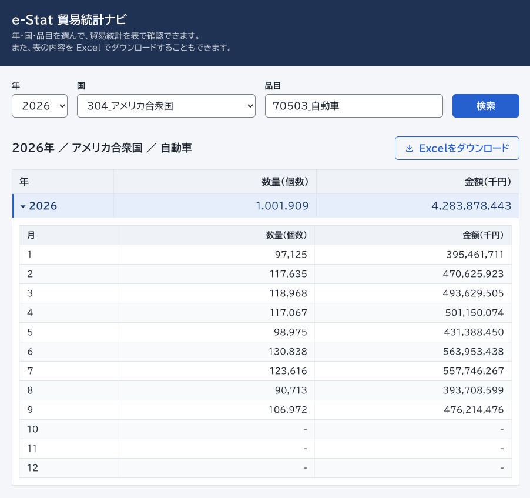
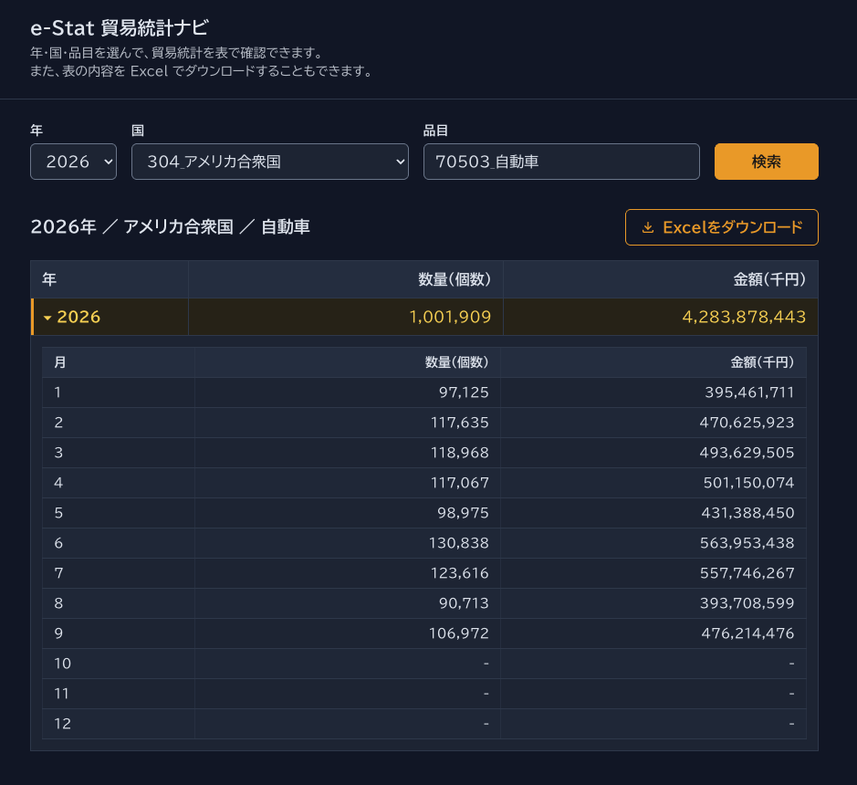
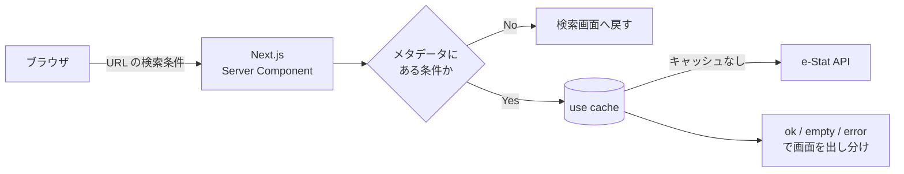

# e-Stat 貿易統計ナビ
 
国・品目・年を指定して、e-Stat の貿易統計を時系列の表で表示し、Excel でダウンロードできる Web アプリです。
 
**🔗 https://e-stat-beta.vercel.app/**



 
## なぜ作ったか
経済レポートを書く友人は、日々の調査や指標分析のためにe-Statから貿易統計を大量にダウンロードし、Excelで膨大なマクロを組んで結合していた。
まずは「国・品目・年を選ぶだけで月次の表とExcelが手に入る」ところまでを作り、今後は複数年・複数品目・複数国で検索できるようにし、更に手間を減らしていく。
 
## できること
- 年・国・品目を選ぶと、月次の数量・金額を表で表示
- 検索結果を Excel でダウンロード（1行＝1か月の縦長形式）

## 技術スタック
 
| 分類 | 技術 |
| --- | --- |
| フレームワーク | Next.js 16（App Router / Server Components） |
| 言語 | TypeScript |
| スタイル | Tailwind CSS v4 |
| Excel 出力 | SheetJS |
| テスト | Vitest / Testing Library |
| 開発環境 | Docker |
| CI | GitHub Actions（lint / typecheck / test / build）、Dependabot |
| ホスティング | Vercel |
 
## アーキテクチャ
 

 
## 設計判断
### DB を持たずにキャッシュで済ませる
外部APIのデータをDBに保存して返す方法もあり得たが、貿易統計は月1回しか更新されず、正本はe-Statにある。

DBを持つと、同期処理と運用コストが増えるだけなので、Next.jsのuse cacheで検索結果をキャッシュする形にした。

### 検索条件を URL に持たせる
検索条件は画面内の状態ではなく URL のクエリに持たせた。同じ条件での再検索や共有が URL だけで済み、ブラウザの戻る・再読み込みでも結果が保たれる。

サーバー側で searchParams を読んで描画するため、画面側の状態管理も要らない。その代わり任意の値を送れるようになるため、次の「メタデータでの検証」で受ける。

### 検索条件をメタデータで検証してから API を呼ぶ
前述の通り、検索条件は URL で受け取るため任意の値を送れる。

e-Stat は存在しない条件でも 200 を返すので、そのまま投げると検索結果のキャッシュが条件の数だけ増え、e-Stat への不要なアクセスも増える。

そこで、統計表のメタデータにある国・品目・年だけを有効な条件とし、それ以外は API を呼ばずに検索画面へ戻すようにした。

### 結果を ok / empty / error の 3 状態に分ける
e-Stat はデータが無くても 200 を返すため、「該当データなし」と「取得失敗」を区別しないと、一時的な障害で取れなかった結果が「データなし」としてキャッシュされてしまう。

キャッシュ対象の関数では取得失敗を throw してキャッシュに残さず、外側で ok / empty / error の3状態に振り分けて、画面の表示も変えている。

### 年 → 統計表 ID の対応表を持つ
貿易統計は、おおむね5年ごとに別の統計表（別の ID）に分かれている。対応表を持たないと、検索のたびに「その年がどの統計表にあるか」を e-Stat に問い合わせる API 呼び出しが、データ取得の前に1回余分に必要になる。

統計表が増えるのは5年に1度程度なので、年 → 統計表 ID の対応表をコードに持ち、新しい表が追加されたときに手で追記する運用にした。追記の手間より、毎回の検索の速さを優先した。
 
## ローカルでの起動
 
### 1. e-Stat のアプリケーション ID を取得
 
[e-Stat API](https://www.e-stat.go.jp/api/) でユーザー登録し、マイページからアプリケーション ID を発行してください。
 
### 2. 環境変数を設定
 
`.env.local` を作成：
 
```
ESTAT_APP_ID=your_app_id
```
 
### 3. 起動
 
```bash
docker compose up --build -d   # 初回
docker compose up -d           # 2回目以降
```
 
http://localhost:3000 で起動します。
 
### 開発用コマンド
 
```bash
npm run test        # テスト
npm run lint        # Lint
npm run typecheck   # 型チェック
```
 
## 今後の予定

- [ ] 複数年の取得
- [ ] 輸出 / 輸入の切り替え
- [ ] 年・国・品目の複数選択
- [ ] Excel を 2 シート構成に（概況品 → 各国の月次 / 国 → 品目別の月次）

## データの出典
 
このサービスは、政府統計総合窓口(e-Stat)のAPI機能を使用していますが、サービスの内容は国によって保証されたものではありません。
 